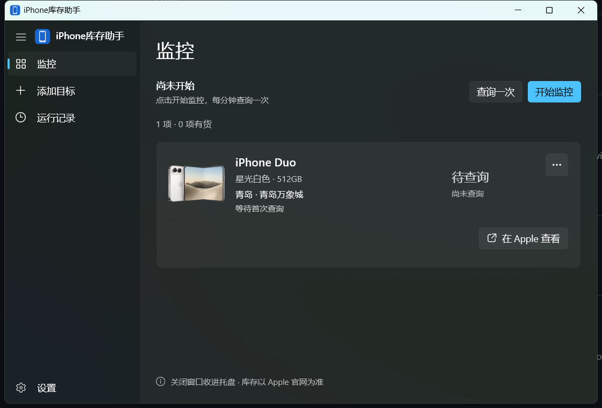
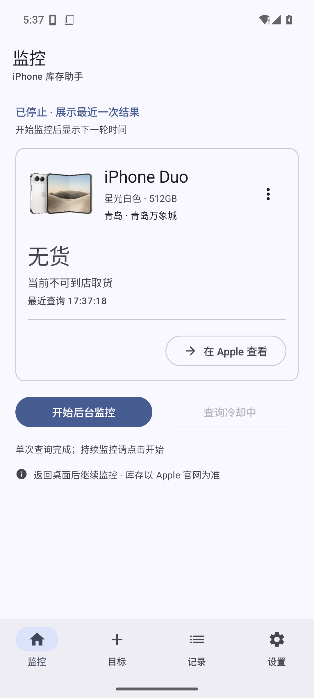
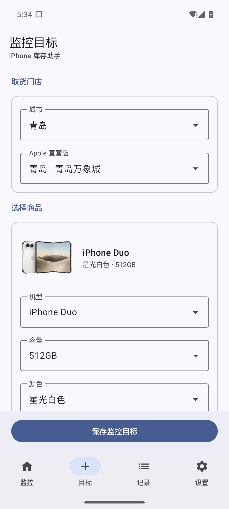
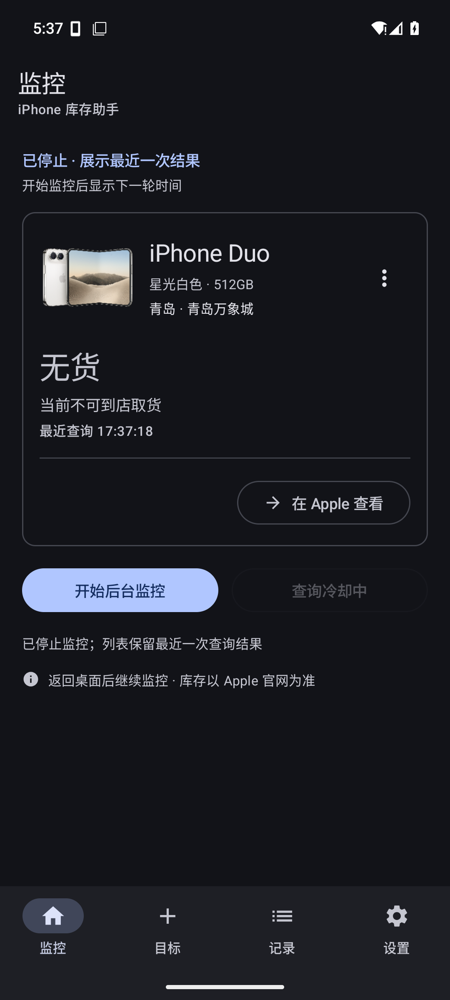
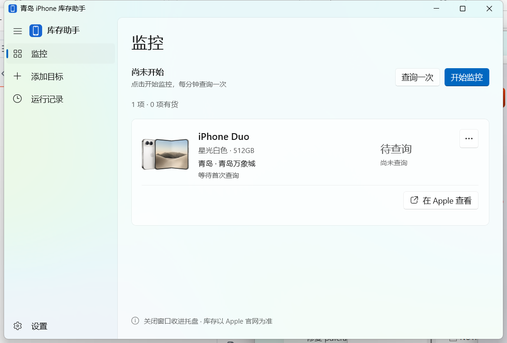
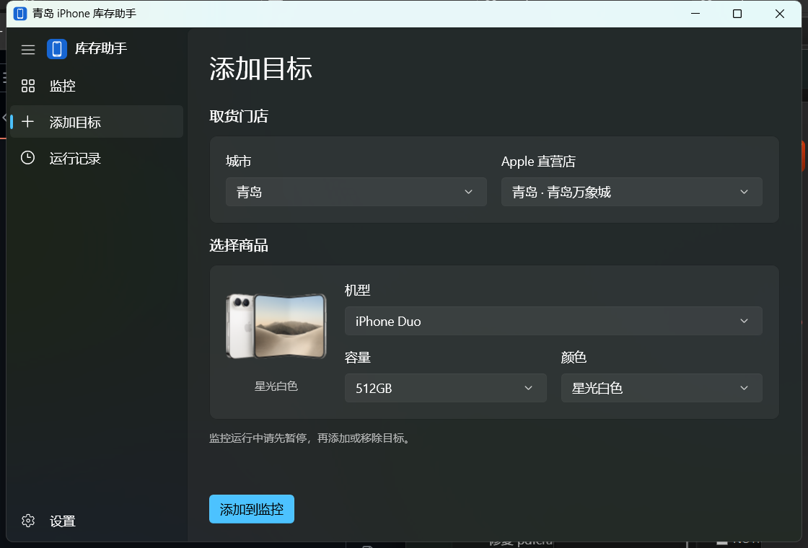
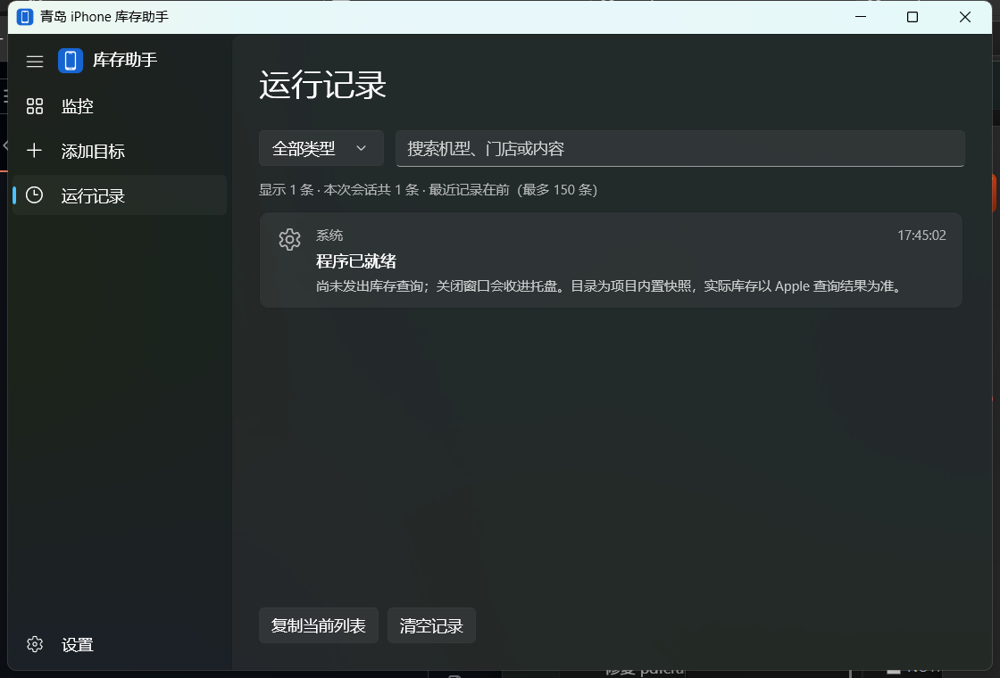
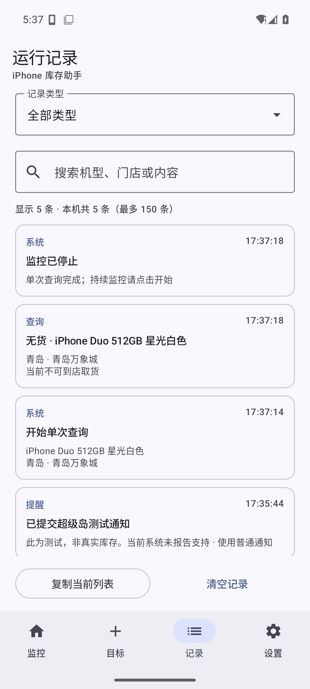

<p align="center">
  
</p>

<h1 align="center">iPhone库存助手</h1>
<p align="center">Keep an eye on iPhone pickup availability.</p>
<p align="center">WinUI 3 · Material 3 · 到货提醒 · 独立运行</p>

关注 Apple 中国大陆直营店的 iPhone 到店取货库存。选好门店、机型和配色，开始监控；有货时提醒，一键打开对应款式的购买页。

**[下载 Windows 版](https://github.com/zhxil/iPhoneStock/releases/latest)** · **[下载 Android 版](https://github.com/zhxil/iPhoneStock/releases/latest)** · [构建说明](#从源码构建) · [更新记录](docs/releases/v1.3.1.md)

## 界面

Windows 使用原生 WinUI 3，监控、目标、记录与设置独立呈现，支持系统深浅色切换：



Android 使用 Google Material 3，支持动态取色、分类记录与预测性返回：

<p align="center">
  
  
  
</p>

<details>
<summary>更多截图：浅色模式、添加目标与运行记录</summary>

Windows 浅色模式：



选择直营店、容量与配色：



按类型筛选、搜索与复制运行记录：



<p align="center">
  
</p>

</details>

截图来自实际 Windows 程序与 AOSP Android 36 模拟器。部分 Windows 截图拍摄于更名前版本；Android 截图不代表小米超级岛的实机效果。

## 功能

- 按城市、直营店、机型、容量和颜色选择目标，显示对应款式的离线商品图。
- 区分有货、无货和未知；查询失败不会误报无货，持续有货不会重复提醒。
- 购买按钮打开对应商品的 Apple 页面；移除目标需二次确认。
- 查询节流、异常退避与拦截冷却，查询间隔最少 60 秒。
- Windows 支持多目标、同城合并查询、托盘后台、任务栏监控胶囊和开机启动。
- Windows 提供提示音与可选 Bark / 飞书推送；任务栏胶囊显示对应商品图。
- Android 独立查询，提供前台服务、常驻通知、到货提醒和最近 150 条持久记录。

## 使用

从 [Releases](https://github.com/zhxil/iPhoneStock/releases/latest) 下载适合的平台版本，校验文件随附件提供。

| 平台 | 版本 | 下载文件 |
| --- | --- | --- |
| Windows x64 | 1.3.1 | `iPhoneStock-Windows-x64-v1.3.1.zip` |
| Android 8.0+ | 1.1.0 | `iPhoneStock-Android-v1.1.0.apk` |

**Windows**：解压完整文件夹，双击 `IphoneStock.exe`，选择目标后开始监控。便携包自带 .NET 和 Windows App SDK，无需另装运行库。关闭窗口后收进托盘，电脑需保持联网且不休眠。

**Android**：安装 APK，允许通知，选择目标后开始后台监控。可按需放行省电限制；手机独立运行，不依赖 Windows 程序或 Google Play 服务。详细操作见 [Android 使用说明](android/README.md)。

默认目标为青岛万象城的 iPhone Duo 512GB 星光白色，可自行更改。内置商品目录为参考项目快照，当前不在线更新。**实际库存以 Apple 官网为准，到货提醒不预留商品，工具不自动下单。**

### 后台与提醒

Windows 可在设置中启用“开机启动并开始监控”。配置保存在 `%LOCALAPPDATA%\QingdaoIphoneStock`，为兼容已有版本保留原目录名；移动程序目录后需重新保存开机启动设置。

Android 15+ 的 `dataSync` 前台服务通常受后台 24 小时合计 6 小时预算限制，超时后会停止并提示，不能保证全天每分钟持续查询。重启、强制停止或服务结束后需重新开始。

小米焦点通知 / 超级岛参数与测试入口已接入。**当前未取得小米 App ID 与官方授权，不能保证直接上岛**；普通常驻通知和到货提醒仍可使用。详见 [超级岛接入说明](android/SUPER_ISLAND.md)。

## 从源码构建

### Windows

需要 .NET 10 SDK、Visual Studio Windows 应用开发工具与 Windows SDK，在 PowerShell 中执行：

```powershell
git clone https://github.com/zhxil/iPhoneStock.git
cd iPhoneStock

# 核心检查与自包含发布。
./scripts/build.ps1

# 生成便携包与对应源码。
./scripts/package.ps1
```

可用 `-Dotnet '<dotnet.exe路径>'` 指定 SDK，`-FallbackPackages '<NuGet缓存目录>'` 指定依赖缓存。默认输出 `dist/青岛iPhone库存助手`，沿用原路径以兼容已有启动配置。

### Android

需要 JDK 17+、Gradle 9.4.1、Android SDK 36 与 Build Tools 36.0.0：

```powershell
./scripts/build-android.ps1 -Sdk '<Android SDK路径>' -JavaHome '<JDK路径>' -Gradle '<gradle.bat路径>'
./scripts/check-android.ps1
./scripts/package-android.ps1
```

界面采用 Kotlin / Jetpack Compose / Material 3，查询和后台服务采用 Java；两个客户端均不使用 Rust。依赖与构建细节见 [Android README](android/README.md)。

Android 首次构建会在 `.tools/android-signing` 生成本地签名密钥，请自行备份。自行构建的 APK 与 Release 签名不同，不能覆盖安装发布包。SDK 缓存、签名私钥、本机配置和发布产物不进入 Git。

## 验证

Windows 已通过 21 项核心检查，并完成界面交互、后台生命周期及四页深色→浅色→深色切换验证。Android 已通过 27 项 JVM 检查，并完成 AOSP Android 36 模拟器交互验证。

未完成干净 Windows 虚拟机、实体小米 17 Ultra、长时间锁屏、实际开机重启和外部 Bark / 飞书送达验收。验证概况见 [本版发布说明](docs/releases/v1.3.1.md)。

## 结构

```text
native/
  Stock.Core/       库存查询、调度、推送与配置
  Stock.WinUI/      WinUI 3 界面、托盘与任务栏胶囊
  Stock.Checks/     核心协议与配置保护检查
android/            Android 应用、JVM 检查与接入说明
scripts/            构建、打包与交互验证
docs/images/        实际界面截图
```

基于 [ENCHIGO/apple-pickup-watcher](https://github.com/ENCHIGO/apple-pickup-watcher) 的查询协议与中国大陆目录重新实现，参考提交 `66c1da29941ba30cfa7cc13ba1b8f95a65f5f692`。源码遵循 [GPL-3.0-or-later](LICENSE)，上游版权与修改声明见 [NOTICE](NOTICE)。

商品图片来自 Apple 中国大陆公开购买页，来源与款式映射记录在 `native/Stock.WinUI/Assets/Products/index.json`。图片权利归 Apple 所有，代码许可不授予图片权利。本项目与 Apple 无隶属关系。
